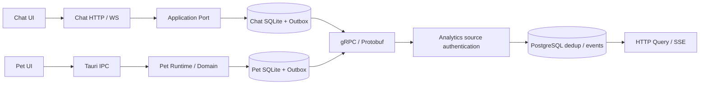

# 系統架構與執行邊界

本頁以 copilot_use/main 原始碼核對，來源 commit 見 [本次紀錄](teaching/history/evidence/2026-10-22-current-docs/README.md)。它描述產品接線；[學習庫目前進度](teaching/current/STATUS.md)、[最終產品需求](P9_TARGET.md) 與功能驗收分開。依賴版本以各 Cargo.lock 為準。

## 既定技術分層與後續教學

架構規則以 [共用規則](COMMON_LEARNING_RULES.md#既定技術分層與-leptos-ui-強制規則2026-10-22-確認) 與 [UI 驗收要求](UI_ALIGNMENT_REQUIREMENTS.md) 為準。以下是沿用既定架構、修正教學偏差的強制要求；不表示本次已套用程式、重跑測試或完成產品驗收，既有實作與缺口仍依目前進度及匹配 SHA 的證據判定。

- **Leptos UI** 負責頁面、元件與互動：Chat 沿既有 SSR／hydration／Router，Pet 沿 Leptos CSR + Tauri，Analytics 正式登入、修改密碼與管理後台逐步接入 Leptos 元件、表單及 Signals／Actions／Resources／Router。不得以 Axum `Html(...)`／`Html(format!(...))` 完整字串頁面取代原有 Leptos UI，或作為新 UI 的完整 Green。
- **Axum HTTP/API** 負責路由、Middleware、HTTP／WebSocket、安全性檢查、Cookie／Session 與服務端 ACL；沿用既有 API／認證契約，頁面呈現與 HTTP Handler 分離。前端隱藏按鈕或 route guard 不能代替服務端授權。
- **Application／Domain** 承擔使用案例、流程及業務／領域規則，透過 Port 銜接外部能力；UI 不直接查 DB，也不承擔服務端授權。**SQLx Adapter** 處理查詢、交易與 migration；Chat／Pet SQLite 與 Analytics PostgreSQL 各自隔離。
- **Tauri IPC** 配合 Pet Leptos CSR，負責原生橋接與視窗操作，業務規則與持久化沿 Application／Domain 及 Adapter 邊界處理。

後續每 Day 的 Red → 完整最小 Green → Refactor 必須核對真實 `Leptos UI → Axum HTTP/API 或 Tauri IPC → Application/Domain → SQLx Adapter` 的當日可操作切片；只有 API/helper、Axum HTML 或假設性頁面成功，不能宣稱 Leptos UI 功能完成。測試、程式套用與功能驗收各自記錄。

下一次教學先逐案讀回已發布 [Day27](teaching/daily/README.md)、最新兩庫 main、規則、manifest、索引與實際 UI／HTTP／IPC／DB／ACL 呼叫鏈，確認架構偏差及已完成內容；新文章編號只取 [learning-state.json](learning-state.json) 當時各案 `next_day`，不把 Day27 或任何後續 Day 寫死、不倒退、不跳號、不重教已完成功能。必要修正放後續適用 Day 的 Red／完整 Green／Refactor 後，或依保留原 commit／blob／SHA256 的版本化勘誤流程處理；Day25（含）以前封存及 Day26／Day27 已發布正文與歷史證據不因規則同步回寫。核對、修訂與文件同步不增加 Day。

## 產品組成

| 元件 | 入口與職責 | 資料／執行 |
| --- | --- | --- |
| Chat Web/API | [server main](../apps/server/src/main.rs)：Axum 路由、帳號／Session、房間授權、HTTP／WS／SSE | Chat 獨立 SQLite；本地 3001 |
| Chat UI | [ui](../crates/ui/src/lib.rs) 與 [前端入口](../apps/server/frontend/src/main.rs)：Leptos SSR／hydration，呼叫 HTTP／WS | 不直接連 DB；資產 `target/site/pkg` |
| Chat 核心 | [chat_domain](../crates/chat_domain/src/lib.rs) → [chat_application](../crates/chat_application/src/lib.rs) → MessageRepository | 不匯入 DB／HTTP driver |
| Chat 儲存 | [persistence](../crates/persistence/src/lib.rs)：ChatWriter、訊息／Outbox／realtime 交易 | migration 在 `crates/persistence/migrations` |
| Pet Native/UI | [Tauri 入口](../apps/desktop_pet/src/main.rs)、[前端](../apps/desktop_pet/frontend/src/main.rs)：生活窗、控制窗與 IPC | 獨立桌面程序；不由 local-services 管理 |
| Pet 核心 | [pet_domain](../crates/pet_domain/src/lib.rs)：Profile、儲存 Port、複習規則 | 純核心，不依賴 Tauri／SQLx |
| Pet Runtime | [pet_runtime](../crates/pet_runtime/src/lib.rs)：PetStore、SQLite、檔案、OS 操作、Outbox、AI Adapter | 自有 app data／`PET_DATA_DIR`；migration 在 runtime |
| Analytics | [main](../apps/stats_server/src/main.rs)、[路由](../apps/stats_server/src/lib.rs)：Dashboard／Query／管理、HTTP 與 gRPC 攝取、SSE | 獨立 PostgreSQL；本地 3100 |
| Analytics 核心與儲存 | `apps/stats_server/src/application`／`persistence` 模組：EventRepository、驗證、交易去重 | migration 在 `apps/stats_server/migrations` |
| 跨產品契約 | [shared](../crates/shared/src/lib.rs)、[analytics_transport](../crates/analytics_transport/src/lib.rs) | ProductEvent／Protobuf、gRPC client/server、逐事件 ACK |
| 外部能力 | `ai_core`、`mcp_bridge`、`telemetry` | Provider／MCP／觀測 Adapter；不作純領域依賴 |

## 資料流與一致性

Chat 先完成持久交易，再對外通知；Pet 的真實檔案操作需 preview／明確確認／receipt，不以純狀態成功取代 OS 結果。Chat／Pet Outbox 保留投遞重試；Analytics 完成資料庫交易後才 ACK，同 ID 去重與衝突分開處理。HTTP JSON 相容攝取入口仍存在。詳細契約及原驗證來源見 [通訊文件](ANALYTICS_TRANSPORT.md)。

三產品不共享業務 DB。Analytics 的查詢 token、管理 token、Chat／Pet 來源 token 分離。**目前 copilot_use Dashboard 仍使用 Bearer token**；人員帳密、Session、角色與來源資料範圍是 [待完成需求](requirements/AUTHENTICATION.md)，不能由學習庫完成紀錄推定此產品已具備。

## 執行及後續接線

本地服務管理器使用 `.local/runtime/chat.sqlite3` 與 `.local/runtime/postgres`，Chat／Analytics 只聽 loopback；Pet 另行建置與啟動。具體步驟及憑證使用見 [本地啟動](LOCAL_START.md)。啟動／healthz 與完整業務驗收分開。

目錄與純層規則見 [程式銜接](TEACHING_ALIGNMENT.md)，關鍵符號與呼叫鏈見 [模組對照](SEMANTIC_ARCHITECTURE_REVIEW.md)，開發缺口見 [FUTURE_WORK](FUTURE_WORK.md)。既有完整兩庫靜態報告保存原來源範圍於 [FULL_SOURCE_REVIEW](FULL_SOURCE_REVIEW.md)，本次未重新做兩庫完整比對或產品測試。

已確認的架構責任維持：Chat 由服務端執行帳號／Session／房間授權；Pet 以 pet id 隔離持久狀態與生活窗；Analytics 將人員 Session／角色與機器配對憑證分離。需求完成須提供匹配 SHA 的跨層及重啟驗收。原文及歷史證據完整保留於 [文件封存](teaching/history/evidence/2026-10-22-current-docs/README.md)。
