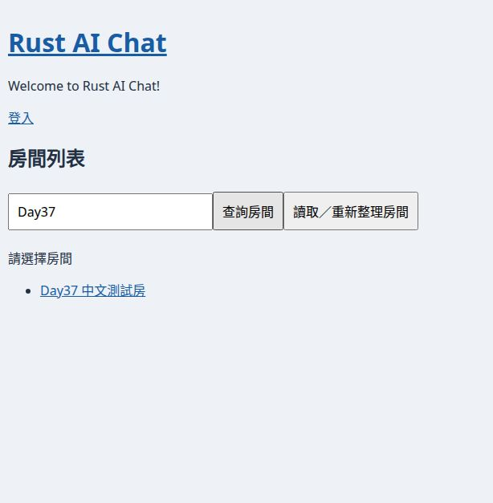

# Day37 三專案驗證與文章修訂（2026-10-25）

程式來源 `rust_ai_ring@648b90323af7b381d6a79dc2fd08a53b63173a43`；文件基準 `copilot_use@af77de7528a03dd46ef933b7d8b63851364b5f8b`。本次從 Git 精確 commit 匯出隔離快照，避免混入本地尚未提交的 Chat 房名／ID 顯示修改；本地來源 main 仍在744a75f，未被本次驗證覆蓋。產品遠端未寫入，產品快照程式未修改。

## 結果

| 專案 | 本次自動驗證 | 真操作／缺口 | 判定 |
| --- | --- | --- | --- |
| Chat | UI 15 passed，含 Day37 Signal；hydrate check、Leptos SSR／JS／WASM build 通過 | 真瀏覽器成功搜尋、空結果、恢復重試通過；HTTP 500 保留清單，但沒有錯誤／重試提示 | 部分驗證通過，Day37 顯示契約未完整通過 |
| Pet | persistence 4 + server／整合 58 = 62 passed，含 Day37 四個 coordinator 與讀 flag；WASM check 通過 | 使用者確認控制窗、生活窗正常與同 ID 重複出籠只有一窗；故障注入／併行壓力／直接關窗／重啟／漫遊未驗收 | 自動測試與 GUI 局部通過，非完整驗收 |
| Analytics | 完整 PostgreSQL targets 45 passed、1 ignored；該 ignored 項另跑 1 passed；正式 Router Day37 測試通過 | 真 PG fixture，未跑外部瀏覽器；角色／來源 ACL／SSE 仍缺 | 本次測試通過，產品與 CI 未完整驗收 |

[機器結果](day37-verification-648b903/summary.json) · [原始 logs／瀏覽器 AX／環境與版本證據包](day37-verification-648b903/evidence.zip) · [官方版本重新查核](day37-verification-648b903/official-versions.json)。

## Chat：成功與失敗必須分開認定

原始 r2 的 apply_room_search、真 WASM caller 與測試已在來源 main；本次 15 項 UI 測試通過不代表畫面完全接通。RoomList 把 loading／查詢結果寫入 status，但目前 DOM 只讀 room_list_feedback，沒有 status.get()。在 task-only SQLite 以可回復的表名變更注入 API 500，按查詢後畫面仍是「請選擇房間」與舊房間連結，未出現錯誤與重試文案；恢復表名後再次搜尋正常。無正式 DB 被修改。

需後續修補真實畫面狀態綁定與瀏覽器失敗測試；不能只刪除舊 status 節點就當作單一狀態完成。首次首頁自動載入、登入／管理文字、房名與小字 ID 屬既有需求／本地另外修改，不混入本次 Day37 精確來源通過數。WS 撤銷競態、歷史及 ACL 仍按原項追蹤。

## Pet：人工觀察與自動證據分開

使用者本次明確回報控制窗正常、生活窗正常、同一隻重複出籠只有一個生活窗。該 native 執行來源是744a75f；Git 比對證明744a75f→648b903的 pet_apps 全目錄無差異，可引用這項 GUI 證據的原範圍，但不改寫其原 SHA。當次 HTTP 資產皆200、資料庫一隻出籠、外鍵無違規；日誌未見 WebKit internal error，但有 EGL 警告。未重現不等於已釐清先前 WebKit 原因。

本次62項測試包含純 closure 的補償順序與 SQLite 真 adapter。它們不等於 Tauri build／show／focus、關窗或 DB 補償 native 故障注入。lifecycle_guard 的鎖單測不等於同 ID 併行 IPC 壓力驗證；固定 pet label 漫遊與預設／回籠模型仍缺。

## Analytics：正式 Router／隔離 PG 與失敗恢復

使用新建、由測試角色持有的專用 DB，SQLx fixture 依完整 migrations 建立測試資料庫。Day37 正式 build Router 驗兩種 summary 路由：合法 Cookie200、服務 token／無 Cookie401、同 header 或多 header 的重複 Cookie401、restricted403、logout後401。這不是只測 raw_cookie helper，也沒有修改正式 DB 或密碼。

初次 URL 預設 anonymous，peer auth拒絕；第二次顯式 willie 仍對 postgres 缺少建 schema 權限；換 task-only DB 後全 targets通過。原 ignored 註記寫 ANALYTICS_TEST_DATABASE_URL，但真實程式讀 DATABASE_URL，第一次另跑因缺變數失敗，校正命令後1項通過。該 ignored 測試為 legacy admin 路徑，不冒充正式 Leptos／password_login 瀏覽器驗收。全部初始錯誤與恢復 log保留。

## 同 SHA CI：六成功、一失敗

Persistence [run40202563244](https://github.com/williechen/rust_ai_ring/actions/runs/40202563244)、job121196631294的 Test Pet Persistence 實際執行 cargo test --locked -p pet-server -p pet-persistence，runner缺 glib-2.0.pc／gobject-2.0.pc，native依賴編譯失敗，exit101。不能把它解讀為 Day37 SQL斷言失敗。

workflow 已配置完整 analytics-server + analytics-persistence --features postgres-integration；但該步因前面的 Pet native 失敗而 skipped。本次不能再沿用舊文「CI未選server PG」的診斷，也不能宣稱它已在 CI 跑通。其餘六 workflow success，只代表其實際覆蓋，並非整體成功。原始快照與失敗摘錄在證據包；本次沒有修改 workflow、安裝系統套件或重跑 CI。

## 版本、文章與進度

當日重新直接讀官方 crate API／Rust stable manifest、PG release及SQLite版本證據；精確資料在 official-versions.json。來源四 workspace manifest／lock以648b903逐檔保存雜湊；沒有 cargo update、改 lock、套新 migration 或安裝工具。

三篇以 Day37 r3 新檔更新驗證狀態，r1／r2 原文與來源 commit／blob／SHA256 不變。每篇獨立提交、精確 commit 全文讀回與保存 blob／SHA256，另同步七首頁、三 ENTRY、STATUS、learning-state與manifest。三案 next_day維持38，不新增 Day、不結案FIFO、不更新last_full_comparison、不做封存。沒有將局部測試認定為整體 Gate2。
