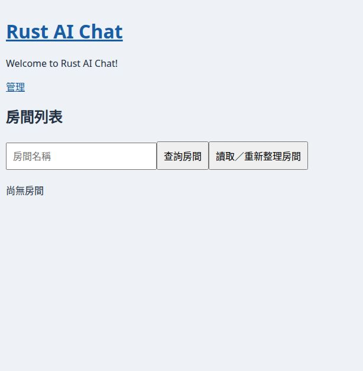
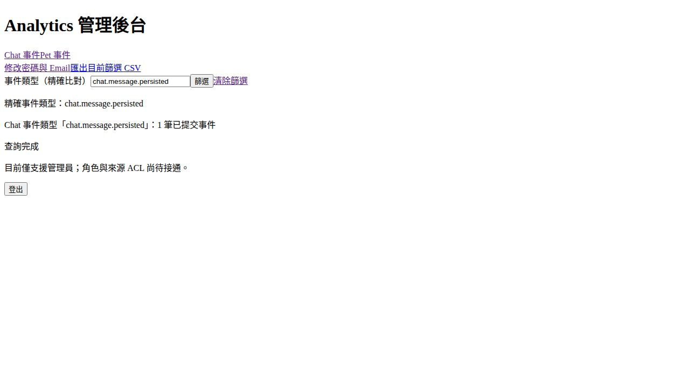

# Day40 最新來源真正重跑：Cargo、瀏覽器與 CI 權限結果

2026-10-26；來源 `rust_ai_ring@9c767978b20bd56e1c2182dac2f37e6ae9b7d988`。使用隔離 clone 與專用資料庫，原始產品工作樹未改碼、未推送。這是新 SHA 的實際重跑；不取代或改寫先前各 SHA 的失敗／候選成功證據。

| 專案 | 本輪真正執行 | 結果 |
| --- | --- | --- |
| Chat | fmt、SSR check、workspace SSR test、WASM check、cargo leptos build | 全 exit0；Rust 59 通過 |
| Pet | fmt、server check/test、Application／SQLite tests、WASM check、Node tests | 全 exit0；Rust72（server60＋Application8＋SQLite4）、Node6 通過 |
| Analytics | fmt、check、帶 postgres-integration 的 server／persistence tests、單獨 ignored test、server build | 全 exit0；52＋ignored1＝53 項不同測試通過 |

[每條命令、cwd、exit、耗時、環境及 log SHA256](commands.jsonl) · [完整機器紀錄](verification.json) · [可重現 Cargo 腳本](reproduce-cargo.py)。編譯有既有 dead_code／unused import 警告，沒有據此修改產品。一般 Analytics suite 中的 ignored 項不是通過數，另以 `--ignored --exact` 實跑1項；見 analytics-ignored.log。

## 真瀏覽器操作

Chat：訪客首頁「登入」→使用拋棄式會員登入→`/account` 個人管理（無404）→首頁「管理」→點管理→登出→重載仍顯示「登入」。[步驟與限制](gui-chat-result.json)，瀏覽器 error／warn 為空。

Analytics：獨立空 PG 資料庫，啟動 bootstrap 後以 backend fixture 設 `is_init_pd=false`，登入後 Chat總數2→精確類型1→實際下載 CSV→解析只有 `web_chat,chat.message.persisted,1`→清除回2→Pet來源1→登出。[步驟與 fixture 範圍](gui-analytics-result.json) · [下載 CSV](analytics-filtered.csv)。首次改密碼 GUI 沒有執行；不是完整帳號／角色驗收。

Pet 真原生多窗、實際點 X、故障注入／重啟 GUI 未執行：目前控制介面只提供瀏覽器，沒有原生桌面操作 surface。Rust／Node 通過不能當作這些 GUI 已通過。Chat 房間 ACL／Session到期 GUI、Analytics 外部試算表也未做。

## CI 實際請求與限制

已請求重新執行 Chat build、Pet server test、Analytics check 三個 job，三次都回 **403 Resource not accessible by integration**；沒有啟動新 CI attempt，不能宣稱本輪 CI 重跑成功。[原始拒絕紀錄](ci-rerun-denials.json)。[同 SHA 現存 workflow 最後觀察](ci-observed-final.json)只作既有遠端結果，與本輪重跑分開。

## 歷史與範圍

目前程式已含 Day40／修復，這輪按精確 SHA 原樣測試，沒有重貼已套用 patch。既有標準 git apply --check／apply 記錄仍在 [來源更新](../source-update-9c76797/README.md) 與 [前輪實測](../local-validation/README.md)。不把靜態 hunk、來源相同或遠端舊 CI 改稱新編譯測試。

三案 next_day 仍41；FIFO、last_full_comparison與重構計功不變。完整Gate2未通過。暫存清理及原始工作樹檢查見 cleanup.json。
