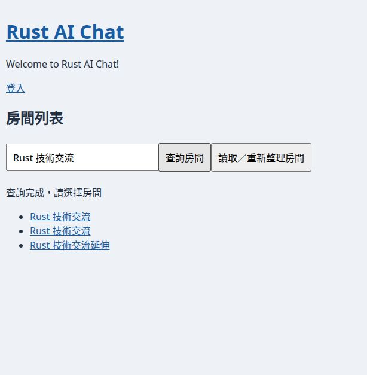
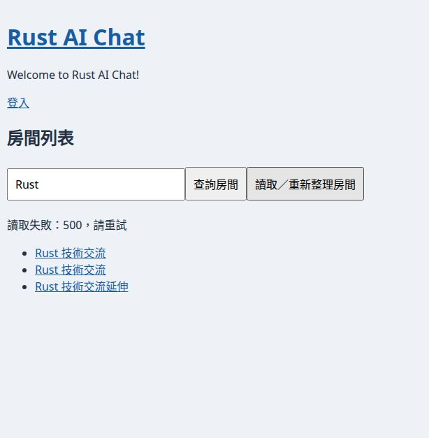
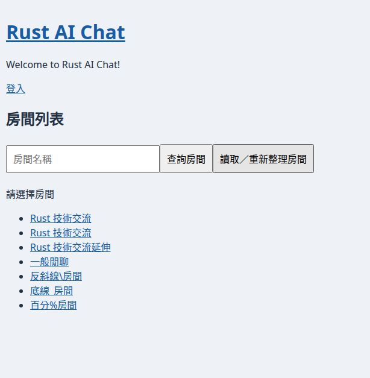
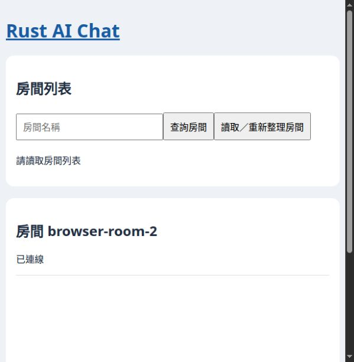

# Chat瀏覽器、SQLite舊庫升級與稽核驗收

日期：2026-10-23T12:45:07.066127+08:00（Asia/Taipei）。程式 `rust_ai_chat/main@9c2b7cf5a4c60a08254445911916c4ed9b02d7b3`；文件基準 `copilot_use/main@1a27390916fbf28ee6582b452362cf4978c96fce`。本輪回應指定的「待瀏覽器驗收」與「SQLite schema及搜尋存在」五列，沒有重跑前輪所有84篇或其他專案。

**Chat Day17／19／20本篇瀏覽器切片通過；Day15列表／選房通過但保留建房UI的要求未達成，只部分通過；Day18已完成實測但升級與稽核未通過。** [更新後完整矩陣](ALL_ARTICLES.md)。歷史正文不回寫，GitHub原84篇矩陣入口已同步五列，其他列維持原證據及範圍。

## 原樣建置與真正瀏覽器

從精確SHA、完整原lock執行，產品原始碼未變：

```bash
CARGO_TARGET_DIR=/absolute/isolated/target cargo leptos build --frontend-only --cargo-locked
CARGO_TARGET_DIR=/absolute/isolated/target cargo leptos build --server-only --cargo-locked
```

兩者exit0。cargo-leptos會加入自己的編譯旗標及LEPTOS_OUTPUT_NAME，不能把先前單獨cargo build產生的SSR資產命名與cargo-leptos前端任意混用。本輪伺服器／前端皆經cargo-leptos建立，環境LEPTOS_OUTPUT_NAME=rust_ai_chat、LEPTOS_SITE_ROOT為本輪生成的target/site；JS及WASM都由真正/pkg路由回200。檔案hash見[build-artifacts.json](logs/build-artifacts.json)。只清本輪／前輪本chat產生的編譯cache節省磁碟，JS/WASM與實測binary保留至驗證結束。沒有修改Cargo、lock、migration或產品Rust碼。

使用CUA操控真正內嵌瀏覽器的輸入、按鈕與房間連結，未以jsdom、mock fetch或HTTP回應替代畫面互動；沒有透過任意JS改DOM製造結果。伺服器只綁127.0.0.1:3000，使用全新隔離SQLite、7筆合成房間、1個測試帳號。沒有讀使用者正式DB或執行付費AI。測試完成已停止本輪伺服器；既有其他服務保留。

| Day／流程 | 實際觀察 | 判定 |
| --- | --- | --- |
| Day15 列表→選房 | 點讀取載入7筆；登入後點第二個同名房，導向/room/browser-room-2，標題ID一致，WebSocket已連線；但首頁／個人頁沒有原文要求保留的建房UI | 部分通過，不列完成 |
| Day17 中文完整／部分名稱 | Rust技術交流的兩個同名ID及延伸名稱共3筆；部分「技術」仍3筆 | 通過 |
| Day17 英文大小寫／trim | rust、帶前後空白的Rust技術查詢符合既有SQLite LIKE與UI篩選契約 | 通過；未宣稱完整Unicode case folding |
| Day17 LIKE特殊字元 | %、_、反斜線各只找到對應字面名稱；SQL注入字串無匹配 | 通過 |
| Day17 空結果 | 不存在房間顯示「沒有符合條件的房間」，不保留錯誤的舊清單冒充結果 | 通過 |
| Day19 真DB故障 | 在本輪DB將rooms暫改名，正式HTTP查詢回500；瀏覽器顯示錯誤與重試、保留query與舊rows | 通過；本輪注入的是500，不聲稱重跑503 |
| Day19 故障後rows完整性 | 錯誤後只清除輸入篩選，不發新查詢，即看見原7筆；證明完整舊快照未被清空 | 通過 |
| Day19 恢復及重試 | 還原原rooms表，在同一頁重按查詢／刷新即可成功 | 通過 |
| Day20 刷新成功 | 舊query自動清空，完整7筆顯示，不被前一搜尋二次過濾 | 本篇切片通過 |
| Day20 刷新失敗 | HTTP500保留query與舊快照；恢復DB後刷新成功且query清空 | 通過 |
| 登入與訊息佐證 | 真瀏覽器表單登入→account→首頁→選正確房→Send；訊息回顯，SQLite確有一筆、room_id正確 | 只佐證呼叫鏈，不結案Day16 |

原始UI狀態與逐項結果見[browser-ui-results.json](logs/browser-ui-results.json)。截圖只含合成測試資料。






## Day18：SQLite schema、舊庫migration與稽核

目前schema／搜尋與舊庫升級分開驗，沒有修改checksum讓它假通過。使用真正server內嵌的SQLx migration runner。原樣fa0888e六份migration從Git精確blob取回，依SQLx0.9.0的Sha384(sql)演算法建立忠實migration history；這是重建歷史fixture，不是實際使用者舊庫。另建只含舊22554歷史的對照fixture，避免其他早期migration先擋住、掩蓋此項差異。

| Fixture／條件 | 最新原樣runner實際結果 | 資料保留 |
| --- | --- | --- |
| 目前schema既有DB重開 | 正常啟動，9份migration；7筆房與測試會員保留 | 邏輯資料庫完全相同 |
| fa0888e完整舊schema＋有效log row | Migrate(VersionMismatch(20260930034455))；主線已變動更早的rooms migration，因此先停此處 | 原row／schema／history完全保留 |
| fa0888e完整舊schema＋NULL log ID row | 同上，尚未走到22554，不能稱NULL修補已執行 | 原row／schema／history完全保留 |
| 只保留原fa22554歷史＋有效log row，其餘現行 | Migrate(VersionMismatch(20261018122554)) | 原row／schema／history完全保留 |
| 只保留原fa22554歷史＋NULL log ID row，其餘現行 | 同上；沒有自動前向修補或清掉NULL row | 原row／schema／history完全保留 |
| 人工加入不存在的applied version之隔離fixture | Migrate(VersionMissing(20261001000000))；這是假設錯誤fixture，不宣稱該版本是真歷史 | 原row／schema／history完全保留 |

目前chat_action_log的missing id、NULL id、UPDATE id=NULL、duplicate id全部被拒。有效id可保存，**但created_user_id填不存在的人員仍成功**。對本輪原樣全部Rust碼搜尋沒有chat_action_log寫入呼叫者；實際完成註冊／登入／選房／發送後，messages有1筆而chat_action_log仍0筆，見[after-browser-db.json](logs/after-browser-db.json)。因此資料表存在與ID限制通過，不能當成已授權、可追溯的稽核流程完成。

[六個runner案例與schema限制完整結果](logs/sqlite-audit-results.json)，完整重現腳本[sqlite_audit.py](sqlite_audit.py)。程式沒有新增前向migration、還原舊migration或替任何實庫改checksum；修正方案仍需先分類已套不同migration版本的舊庫，依各歷史選可追溯、保留資料的前向升級策略。不能直接照舊候選套用或刪庫掩蓋差異。

## 完成記錄、封存與剩餘項

Day17／19／20原本已在歷史封存位置。本輪新增的是3篇「本篇切片驗證完成」證據，不重複搬移或重發；原body／blob／SHA256全部保留。在原6篇完成封存記錄上累計9篇已驗證切片，詳見[完成清單](archive-manifest.json)。Day15列表／選房通過，但原文第2節要求保留建房／聊天程式；現行HomePage只有RoomList，account只有登出與回首頁，沒有建房UI。依現行需求建房應放個人管理頁，不能拿匿名POST建房201替代UI完成，因此Day15不加入完成名單。Day18既有封存身分保留，但狀態改為「實測失敗」，不能加入完成名單。next_day三案仍30、makeup_queue與last_full_comparison不動，沒有新增Day、改排程、修改Notion或寫產品庫。

本輪沒有順便結案Chat Day16：其歷史未接通提示的SSR斷言仍是前輪失敗；發訊雖回顯且持久化，畫面狀態仍寫「已發送，等待回應...」，未宣稱完整訊息狀態驗收。房間成員ACL／匿名API建房、SQLite任意actor、真稽核寫入、舊庫升級、其他瀏覽器／跨平台仍須各自修正或驗收。新發現與剩餘問題沿原功能項追蹤，不用本次瀏覽器通過替它們結案。

### 完成判定更正

初次瀏覽器補驗提交b79f92e以列表／選房的主切片將Day15也列完成；回查原文「保留建房功能」與目前首頁／個人頁後，發現入口缺失，已在本次最終結果撤銷Day15完成判定。初次提交及其讀回證據保留歷史，最新完成數為3篇新增、累計9篇。原文沒有改寫，產品程式沒有套修補。
