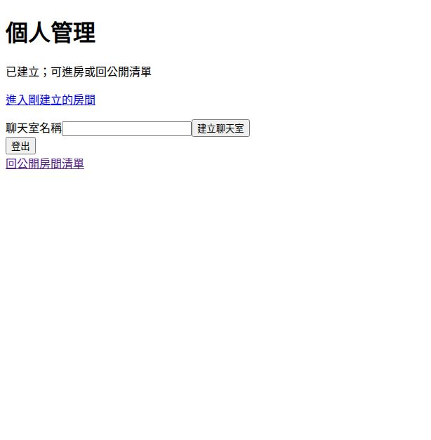

# 本地正式驗證｜未全部通過

驗證時間：2026-10-23T23:38:30.233513+08:00（Asia/Taipei）。本地已先由 `08b891a` fast-forward 至 `7b01610`，驗證途中再同步至最新 `be0494a2a70be91eb74b2b726970a23fc3e5c044`。本輪只驗 rust_ai_chat；copilot_use 只更新文件、索引與證據。

## 結論與精確來源

最新 `be0494a`：workspace **139 passed／0 failed／1 ignored**；獨立 UI CI 命令 **8 passed／0 failed**。UI SSR **10 passed／1 failed**；嚴格 Clippy 失敗；Pet 歷史 migration 升級仍阻擋，所以正式驗證不得標示全通過。

完整編譯、SSR／WASM、Release、PostgreSQL、HTTP、瀏覽器及原生 GUI 實際來源為 `7b016106058084de7c1d0e19eec061b17ceda063`。後續 `be0494a` 只將 Day31 UI 測試模組由 `#[cfg(test)]` 改為 `#[cfg(all(test, feature = "ssr"))]`；已逐檔 diff 核對生產程式、Cargo.lock、migrations 完全不變。新 SHA 重跑 fmt、獨立 UI、UI SSR 和 workspace；不宣稱其餘項目在新 SHA 全量重跑。原版 workspace 為140通過，最新版139是測試 feature gate 排除一項，不能解讀成產品測試退步。

179個 tracked 檔案（排除.env範本）逐一核對：本地只有既有README修改，驗證副本與本地所有比對檔案相同；既存docs保留。詳見 alignment.json、snapshot-7b01610.json、followup-source.diff。沒有修改或推送 rust_ai_chat 程式、依賴或 migrations。

環境：Linux x86_64、Rust/Cargo1.99.1、Node22.22.1、PostgreSQL18、cargo-leptos0.3.11、Trunk0.21.14。所有 Cargo 依賴命令使用 --locked；沒有升級依賴。本輪不進行官方最新版本選型，因此不以此報告宣稱完成每日文章的版本查核Gate。

## Chat：個人頁建房已可操作，歷史與身分仍有缺口

本輪生產Release binary實際TCP測試：註冊與重複拒絕、大小寫帳號登入、匿名帳戶／進房／WS／建房401、個人頁建房CSRF拒絕403與成功201、JSON API建房201、程序重啟後Session與房間讀回、登出與舊Cookie401，以及SQLite integrity均通過。runtime.json保存24項斷言（包含HTTP與DB／HTML斷言，非24個HTTP request）。

真瀏覽器操作：使用隔離測試會員登入 → 個人頁輸入房名 → 點「建立聊天室」 → 成功回饋與進房連結 → 點擊進房 → 兩個tab顯示同一WS訊息 → 個人頁登出。SQLite唯讀查詢確認該合成訊息恰1筆。

限制實測：重新整理第二頁後，已保存的訊息未載入；登入會員傳送的那筆訊息，DB的author_kind仍為anonymous_user。UI SSR測試在crates/ui/src/lib.rs:484斷言「歷史載入尚未接通」失敗。個人頁建房切片可用，不代表逐房ACL、作者身分、長連線撤銷、歷史／重連、建房API全面CSRF或完整管理已通過。

## Pet：三個原生生活窗與控制窗生命週期

真Tauri／WebKitWebDriver／獨立Xvfb，使用本輪重新建置的native debug binary與Trunk release資產、全新SQLite、隔離XDG資料／快取目錄。

- 從真控制台逐次建立三個不同ID，SQLite保存三筆；建立後可出籠。
- 三個200×200原生生活窗各只有一個.pet-face及單圖SVG動畫；圖片與對應ID見gui/results.json及三份截圖。
- 從控制台讓所選寵物睡眠，只有該生活窗顯示睡眠pose／revision1，另兩隻仍待機revision0；本輪事件權限接線通過。
- 對控制台送真正WM_DELETE_WINDOW，之後從生活窗點「控制台」成功恢復同一控制台。
- 點一個生活窗「回籠子」只關閉該窗，另兩窗保留。
- 停止App再開，控制台讀回三筆儲存清單，DB integrity為ok；**重啟證據只涵蓋profile清單，未證明生活窗自動恢復或出籠標記完整一致**。

最終GUI9項檢查全部通過（含啟動／DB／清理，不當成9個完整產品功能）。初期測試分別遇到JS close未授權、WebDriver close不等於原生關窗、缺xdotool與Xauthority環境問題；皆保留於gui-* attempt資料，不把測試方式問題報成產品缺陷。最終使用整個suite外層Xvfb與Xlib WM事件，不修改capability或產品程式。

仍未執行DB寫入失敗、關窗失敗與補償失敗注入；初始控制台無選取時會顯示「請先選擇並出籠寵物」。沒有宣稱完整多寵物預設出籠、漫遊、拖曳、安裝包或跨平台驗收。

## Analytics：Leptos改密碼與真正PG入口

完整postgres-integration所有targets36通過、0失敗、1 ignored；另以--ignored實際執行該1項並通過，合計覆蓋37項，不能與workspace重疊測試相加。

本輪獨立PG cluster、真正bootstrap CLI透過TTY輸入合成密碼，實際啟動Release stats-server：未登入後台導向登入、首次登入限制、改密碼頁單doctype與Leptos label／input連線、CSRF表單改密碼及Email、舊Session失效、舊密碼拒絕、新密碼重新登入、Dashboard、日後再開改密碼頁200、Chat／Pet各自token攝取201與重送200均通過。analytics-runtime.json保存23項斷言。本輪未重新操作Analytics瀏覽器；先前瀏覽器證據仍只屬原來源，不混作新實測。

## 歷史DB升級探針

以精確舊來源4f0cd00的各案migration，先由SQLx真正套用至隔離空庫，再建立formal_preserved合成資料表與1筆sentinel，執行本輪原始Migrator：

| 升級路徑 | 實際結果 | 合成資料 |
| --- | --- | --- |
| Pet SQLite | **Err(VersionMismatch(20261018095626))** | 保留1筆 |
| Analytics PostgreSQL | Ok(()) | 保留1筆 |

這是migration ledger／checksum相容性探針；sentinel不是實際寵物或管理員資料，不宣稱完成全部歷史cohort與業務資料升級。Pet仍在歷史create_pet_owner.sql加入local_pet_selection，不能以全新DB成功取代舊庫升級證據。沒有改checksum、刪庫或接觸既有使用者資料庫。

## 測試與建置命令

以下原始完整命令以7b01610執行，退出碼與全部log保留於evidence.tar.gz的logs/；--locked沒有升級lock。

| 命令 | exit | log |
| --- | --- | --- |
| `cargo fmt --all -- --check` | 0 | fmt.log |
| `node --test` | 0 | node.log |
| `cargo test --locked --workspace --exclude desktop-pet-frontend` | 0 | workspace-tests.log |
| `cargo test --locked -p server --features ssr` | 0 | server-ssr-test.log |
| `cargo check --locked --workspace --exclude desktop-pet-frontend` | 0 | native-check.log |
| `cargo check --locked -p ui --features ssr` | 0 | ui-ssr.log |
| `cargo check --locked -p ui --features hydrate --target wasm32-unknown-unknown` | 0 | ui-wasm.log |
| `cargo check --locked -p desktop-pet-frontend --target wasm32-unknown-unknown` | 0 | pet-wasm.log |
| `cargo clippy --locked --workspace --exclude desktop-pet-frontend --all-targets -- -D warnings` | 101 | clippy.log |
| `cargo test --locked -p stats-server --features postgres-integration` | 0 | postgres-tests.log |
| `cargo test --locked -p stats-server --features postgres-integration -- --ignored` | 0 | postgres-ignored.log |
| `cargo leptos build --cargo-locked --release` | 0 | chat-release.log |
| `cargo build --locked --workspace --exclude desktop-pet-frontend` | 0 | native-build.log |
| `cargo build --locked -p stats-server --release` | 0 | stats-release.log |
| `trunk build --locked --release` | 0 | pet-release.log |

後續be0494a另跑：cargo fmt（0）、cargo test --locked -p ui（0；8/0/0）、cargo test --locked -p ui --features ssr（101；10/1/0）、cargo test --locked --workspace --exclude desktop-pet-frontend（0；139/0/1）。Server SSR原始26/0/0。WASM兩案與SSR compile通過；Chat Leptos release、Analytics release、Pet frontend release及workspace native debug build通過。未建置Pet原生release installer。

嚴格Clippy實際錯誤：apps/desktop_pet/src/pet_windows.rs:125的collapsible_if；crates/ui/src/lib.rs:299的set_rows unused，以及:41／:58 dead_code。不同features與編譯測試不互相替代；未修程式以讓驗證變綠。

## 同SHA CI快照

7b01610：6個workflow中5 success、1 failure；17 jobs中16 success、1 failure。失敗job為Test All/test-ui；本地同命令重現8 passed／1 failed，Day31 account測試未啟用SSR造成AnyAttribute panic。be0494a只修正該測試feature gate，本地同命令已8/0；**新CI執行中不能記success**。

以下為最新be0494a查核時間2026-10-23T23:37:52.116773+08:00；workflow/job/head_sha與時間見ci-latest.json，舊版快照見ci.json。

| Workflow | Run | 狀態／結論 |
| --- | --- | --- |
| Test All | [39977648774](https://github.com/williechen/rust_ai_chat/actions/runs/39977648774) | in_progress / None |
| Node | [39977648612](https://github.com/williechen/rust_ai_chat/actions/runs/39977648612) | completed / success |
| Rust Dashboard | [39977648560](https://github.com/williechen/rust_ai_chat/actions/runs/39977648560) | completed / success |
| Persistence | [39977648818](https://github.com/williechen/rust_ai_chat/actions/runs/39977648818) | completed / success |
| Rust Desktop Pet | [39977648515](https://github.com/williechen/rust_ai_chat/actions/runs/39977648515) | completed / success |
| Rust AI Chat | [39977648582](https://github.com/williechen/rust_ai_chat/actions/runs/39977648582) | completed / success |

## 邊界、清理與文件同步

Chat／Pet SQLite和AnalyticsPG均為本輪新建；排除.env及既有DB，沒有讀真實秘密或執行付費AI。測試服務、WebDriver、Xvfb與專用PG已停止；既有5432服務不動。服務ports與清理結果見cleanup.json。隔離合成DB留在work供追溯，不放入GitHub證據包。

copilot_use只更新目前狀態、三案導覽、驗收索引、latest_source_validation與本報告／證據；原已發布Day正文與歷史報告不改寫，不封存文章、不結案makeup_queue，next_day維持chat/pet/analytics各32，last_full_comparison維持2026-10-16T22:47:14.399027+08:00。這不是全面兩庫比對、產品全部驗收或週六Gate通過。
