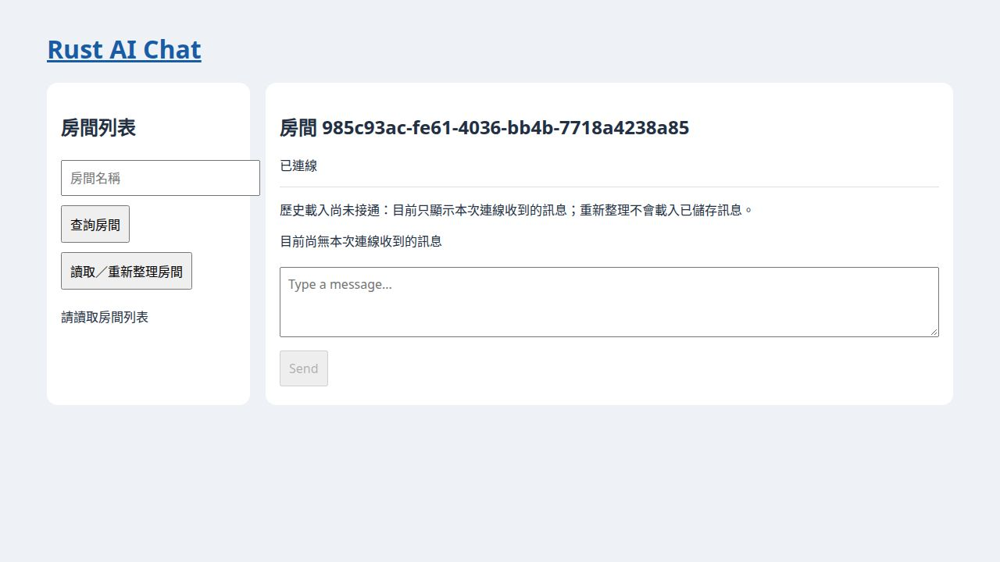
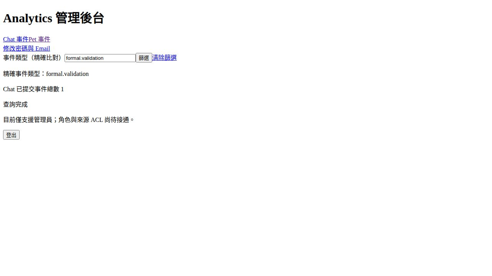

# 清理後冷建置正式驗證｜f3f8255

2026-10-24T08:56:16.845179+08:00（Asia/Taipei）。先將本地rust_ai_chat/main由be0494a fast-forward至 **f3f8255b0b701a1b57cb8c0a1737c3caa4319f2d**（workspace0.2.32），再清理舊測試庫、快取及暫存，所有本輪測試／建置／執行證據均依此來源。本輪不改寫程式或migration來取得通過結果。

## 清理、空庫與判定

**結論：整體未全部通過。** 空庫測試／建置與同SHA CI通過，但嚴格Clippy仍有4項錯誤；產品未完成與歷史庫升級限制另列。

使用者明確授權「連本地應用資料庫一起清空重建」。盤點沒有.env、沒有DB URL環境設定、未發現可識別的應用DB；系統PostgreSQL只有postgres與willie，兩庫的非系統資料表均0，沒有擅自刪除其他DB。**不能宣稱重設了不存在或未定位的應用庫**；本輪刪除舊隔離測試庫，再建立新的Chat／Pet SQLite及專用PostgreSQLcluster驗證。

清除18個已確認路徑，共7.44GiB邏輯大小：舊驗證repo／target、測試SQLite與PGcluster、5組GUI暫存與WebKit資料、原倉庫忽略的frontend/dist與gen、dev.rustai.desktop-pet WebKit資料等。沒有找到需清除的未追蹤編輯器swap／備份檔。共享Cargo registry與toolchain保留；**沒有重用上一輪target**，新建置自然會重新產生本輪產物。原始碼、既有README／docs修改及歷史outputs保留。完整逐路徑／bytes見reset-cleanup.json。

本輪命令／測試結果見下表與SUMMARY.json。相同SHA的CI成功不能取代本地嚴格lint、真實GUI／HTTP或歷史migration驗證；新空庫可啟動不代表舊checksum問題已修正。完整產品仍有歷史／身分、授權、出籠生命週期及失敗注入等未完成項目，不因清庫結案。

## 測試與冷建置

| 範圍 | passed / failed / ignored |
| --- | --- |
| workspace-tests | 142 / 0 / 1 |
| server-ssr-test | 26 / 0 / 0 |
| ui-ci-tests | 8 / 0 / 0 |
| ui-ssr-tests | 12 / 0 / 0 |
| postgres-tests | 37 / 0 / 1 |
| postgres-ignored | 1 / 0 / 0 |

Node3/3通過。PostgreSQL所有feature targets與ignored分別執行，與workspace有重疊覆蓋，不相加為獨立測試總數。全部Cargo依賴命令使用--locked；uuid1.29等變更來自上游Cargo.lock，不是本輪cargo update。Rust/Cargo1.99.1、Node22.22.1、PostgreSQL18、cargo-leptos0.3.11、Trunk0.21.14；實際環境原始輸出在environment.log。未做套件最新版本推薦或每日文章Gate1版本選型。

| 實際命令 | exit | log |
| --- | --- | --- |
| `bash -c rustc -Vv; cargo -V; node -v; rustup target list --installed; pkg-config --modversion gtk+-3.0 webkit2gtk-4.1; cargo leptos --version; trunk --version` | 0 | environment.log |
| `cargo fmt --all -- --check` | 0 | fmt.log |
| `node --test` | 0 | node.log |
| `cargo test --locked --workspace --exclude desktop-pet-frontend` | 0 | workspace-tests.log |
| `cargo test --locked -p server --features ssr` | 0 | server-ssr-test.log |
| `cargo test --locked -p ui` | 0 | ui-ci-tests.log |
| `cargo test --locked -p ui --features ssr` | 0 | ui-ssr-tests.log |
| `cargo check --locked --workspace --exclude desktop-pet-frontend` | 0 | native-check.log |
| `cargo check --locked -p ui --features ssr` | 0 | ui-ssr.log |
| `cargo check --locked -p ui --features hydrate --target wasm32-unknown-unknown` | 0 | ui-wasm.log |
| `cargo check --locked -p desktop-pet-frontend --target wasm32-unknown-unknown` | 0 | pet-wasm.log |
| `cargo clippy --locked --workspace --exclude desktop-pet-frontend --all-targets -- -D warnings` | 101 | clippy.log |
| `/usr/lib/postgresql/18/bin/initdb -D /home/willie/Documents/Codex/2026-10-23/new-chat-2/work/pg-data --no-locale --encoding=UTF8 --auth=trust` | 0 | pg-init.log |
| `/usr/lib/postgresql/18/bin/pg_ctl -D /home/willie/Documents/Codex/2026-10-23/new-chat-2/work/pg-data -l /home/willie/Documents/Codex/2026-10-23/new-chat-2/work/pg.log -o -k /home/willie/Documents/Codex/2026-10-23/new-chat-2/work/pg-socket -p 55438 -h '' -w start` | 0 | pg-start.log |
| `cargo test --locked -p stats-server --features postgres-integration` | 0 | postgres-tests.log |
| `cargo test --locked -p stats-server --features postgres-integration -- --ignored` | 0 | postgres-ignored.log |
| `/usr/lib/postgresql/18/bin/pg_ctl -D /home/willie/Documents/Codex/2026-10-23/new-chat-2/work/pg-data -m fast -w stop` | 0 | pg-stop.log |
| `cargo leptos build --cargo-locked --release` | 0 | chat-release.log |
| `cargo build --locked --workspace --exclude desktop-pet-frontend` | 0 | native-build.log |
| `cargo build --locked -p stats-server --release` | 0 | stats-release.log |
| `trunk build --locked --release` | 0 | pet-release.log |

嚴格Clippy的實際錯誤以clippy.log為準；沒有用一般check成功取代-D warnings。Chat／Analytics release與Pet frontend release、native debug build分開記錄；沒有宣稱Pet native release installer或跨平台已驗收。

## Chat Day32與真實流程

UI SSR12項通過，包含原本失敗的歷史提示與新增Day32空訊息／aria-live契約，上一輪SSR斷言問題已修復。Day32新增的是**未接通歷史的明確揭露**，不是從DB載入歷史功能。

本輪fresh SQLite生產HTTP腳本涵蓋註冊、重複拒絕、帳密登入、匿名帳戶／建房／進房／WS拒絕、個人頁CSRF拒絕與建房成功、API建房、程序重啟讀回、登出與撤銷，逐項見runtime.json。瀏覽器操作與訊息DB核對另見browser-results.json及browser-chat-*.txt；只按實際保存的觀察判定，不將HTTP腳本冒充瀏覽器。

實際瀏覽器：登入→個人頁建房→進房，明確顯示未接通歷史與空訊息；兩頁收到同一廣播，空狀態消失；重新整理後回到空訊息但提示仍在。SQLite恰1筆，作者仍為anonymous_user。

歷史重載與訊息作者身分仍按實測揭露；不把提示存在或空庫測試通過算作完成歷史、逐房ACL、長連線撤銷、稽核或完整管理。

## Pet Day32與原生GUI

以本輪cold-build的native debug binary、Trunk release資產及全新SQLite，在隔離Xvfb／XDG環境驗證三個不同ID的生活窗、單圖／獨立狀態、控制窗原生關閉後恢復、單隻回籠、重啟後profile清單。

Day32另經真實生活窗右鍵開原生選單，選第一項「開啟控制窗」，再核對local_pet_selection與控制台狀態；結果以gui/results.json的具名項目為準。使用WebDriver pointer與Xvfb內XTest鍵盤，沒有直接呼叫select_pet來替代選單路徑。

本輪GUI10項檢查均通過，含Day32原生選單選取。啟動、DB與清理項不當成相同數量的完整產品功能。重啟profile清單不等於自動恢復所有出籠視窗；本輪仍沒有關窗失敗／DB失敗／補償失敗注入、完整漫遊／拖曳或跨平台安裝驗收。

## Analytics Day32：PG、HTTP與可操作篩選

真正TTY bootstrap初始化、新cluster、首次登入限制、Leptos改密碼頁／CSRF、修改密碼Email後撤銷、新密碼登入、日後改密碼、Chat／Pet獨立服務token攝取與冪等，見analytics-runtime.json。

新增合成Chat兩種event_type與Pet一種事件，透過production GET/dashboard驗證來源＋精確類型、清除後總數、空結果、未知來源400及過長類型400；這些HTTP結果與Leptos helper測試分開。真瀏覽器篩選／清除／來源切換的AX與截圖另保存，不以HTML字串測試冒充瀏覽器。

角色、來源ACL、持久登入等待、即時更新、正式機器配對與完整管理仍不由此切片追認完成。

## 歷史migration探針與安全邊界

額外探針先用4f0cd00的真正舊migrations由SQLx建立隔離庫，再插入1筆formal_preserved sentinel，最後跑本輪原始Migrator。實際Pet得到Err(VersionMismatch(20261018095626))，Analytics為Ok(())，兩邊sentinel均保留1筆。完整退出碼與UPGRADE_RESULT／PRESERVED_ROWS見upgrade-results.json和pet-old-upgrade.log／analytics-old-upgrade.log。sentinel不是寵物或管理員業務資料，不代表所有歷史cohort都驗收完成；不改ledger或checksum、不以清庫掩蓋相容性風險。

沒有讀取真實秘密或執行付費AI；測試服務只用loopback／私有Unixsocket，既有系統5432不動。驗證後停止本輪服務，並再次清除本輪測試DB、WebKit快取與暫存，只保留輸出的報告與重現腳本，不保留隔離編譯／測試暫存；清理清單與ports見cleanup.json。

## 精確SHA的GitHub CI

查詢時間2026-10-24T08:43:04.997117+08:00；workflow、job、head_sha、URL與時間保存於ci.json。

| Workflow | Run | 狀態／結論 |
| --- | --- | --- |
| Node | [40044856293](https://github.com/williechen/rust_ai_chat/actions/runs/40044856293) | completed / success |
| Rust AI Chat | [40044856387](https://github.com/williechen/rust_ai_chat/actions/runs/40044856387) | completed / success |
| Rust Dashboard | [40044856166](https://github.com/williechen/rust_ai_chat/actions/runs/40044856166) | completed / success |
| Test All | [40044856153](https://github.com/williechen/rust_ai_chat/actions/runs/40044856153) | completed / success |
| Persistence | [40044856202](https://github.com/williechen/rust_ai_chat/actions/runs/40044856202) | completed / success |
| Rust Desktop Pet | [40044856200](https://github.com/williechen/rust_ai_chat/actions/runs/40044856200) | completed / success |

## 文件更新與未完成

只更新copilot_use目前狀態、三案首頁、驗收索引與有關待辦，加本報告、原始證據、latest_source_validation及精確commit讀回。已發Day正文、歷史報告、makeup_queue與last_full_comparison不改寫；三案next_day維持本輪讀到的33，不因驗證增加Day，也不擅自封存文章。
